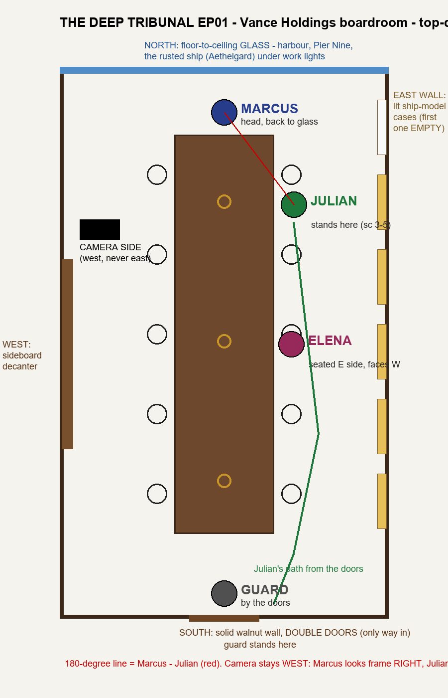

# AI Micro-Drama Pipeline

This is how I make short vertical dramas (9:16, 60–90 seconds an episode) with AI video models without the result looking like "AI slop".

Most AI shorts I watched felt like random 10-second clips glued together: the room changes between shots, faces age, and nobody looks at the person they're talking to. This repo is the method and the tooling I built to fix that, shot by shot.

## The method

**1. Story first.** Before any image is made, each episode has to pass a 12-point story check:
- a hook in the first 3 seconds;
- a clear want by 0:15;
- humiliation, then reversal, then payoff;
- scenes linked by "but / therefore", never "and then";
- a mute test;
- a single-question cliffhanger.

See [`skills/ai-story-architect.md`](skills/ai-story-architect.md).

**2. Lock the world.** Before any video:
- **Characters:** 3-panel character sheets with a numeric age.
- **One room:** one master location plate, with the reverse angles made as *edits* of it so it stays the same room.
- **Blocking:** a top-down map that fixes the seats and the 180° line.

**3. Storyboards built from approved stills.** Every 10-second scene gets a 6-panel storyboard:
- panel 1 = the *exact last frame* of the previous approved scene;
- the last panel = where this scene must end.

The video is generated with that first frame, last frame and storyboard pinned, so continuity carries from scene to scene.

**4. Direct the prompt like a shot list.**
- Timed shots with hard cuts, each with a first-frame line.
- Locked eyelines: the speaker looks at the person they're talking to.
- The speaker's face is on screen for their line.
- Only motivated weather. If you walk in through an office door, you're not wet.

**5. Watch every take.** Each take gets:
- a frame-by-frame contact sheet;
- a Whisper transcript, checked word for word;
- a check on who speaks.

Bad takes are logged with the reason and regenerated with one change at a time.

The full write-up is in [`docs/directing-method.md`](docs/directing-method.md), distilled from Higgsfield Academy lessons, creator breakdowns and micro-drama studio practice.

## Example

[`examples/`](examples) has the story gate, the blocking map, a scene prompt and a storyboard from my current episode, *The Deep Tribunal*: a "dead man" walks into the boardroom of the tycoon who tried to have him killed.

## Tools

`tools/beeftv/` contains small Python helpers that drive a node-canvas app (BeefTV) over its local API:
- `btv_batch.py`: create image/video nodes from a JSON spec, wire the references, generate one at a time.
- `btv_startend.py`: generate a take with a pinned start frame and end frame plus references.
- `board_upload.py`: join 3–6 approved panels into one storyboard and place it on the canvas.
- `upload_card.py`: put any local image on the canvas as a locked reference card.
- `transcribe.py`: faster-whisper transcript with timestamps, for checking dialogue.

Credentials come from environment variables (`BEEFTV_CLIENT_ID`, `BEEFTV_CLIENT_TOKEN`) and are never stored in the code.

## Status

Work in progress. I'm making episode 1 of *The Deep Tribunal* scene by scene, and I'm benchmarking open video models (MiniMax H3 / FastH3) on free and low-cost GPUs: see [fasth3-kaggle-benchmarks](https://github.com/tma-ai/fasth3-kaggle-benchmarks).

— David Udochukwu, Nigeria
